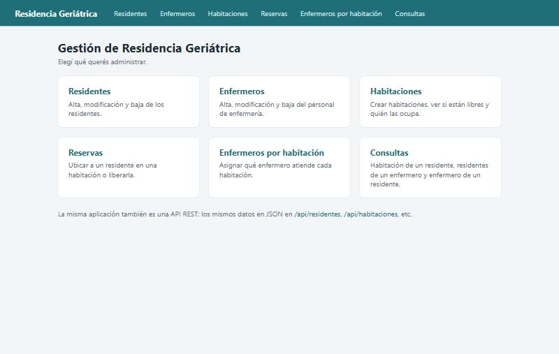
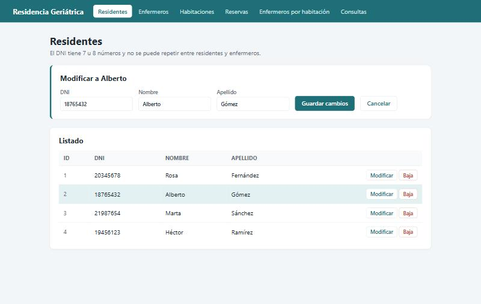
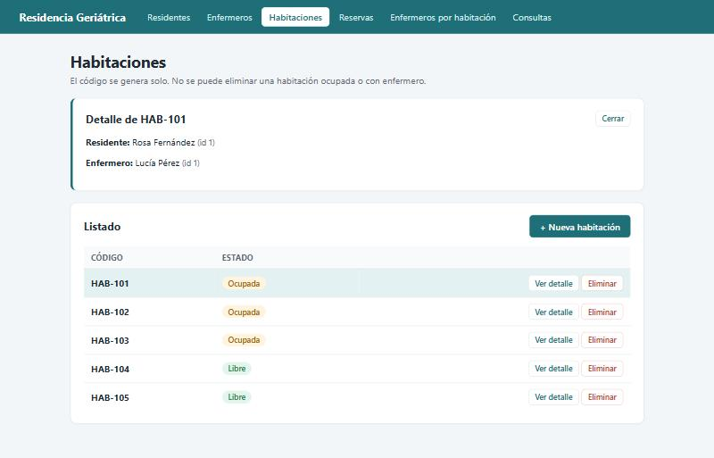
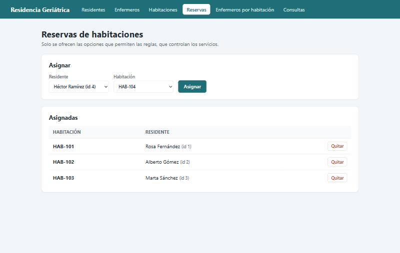
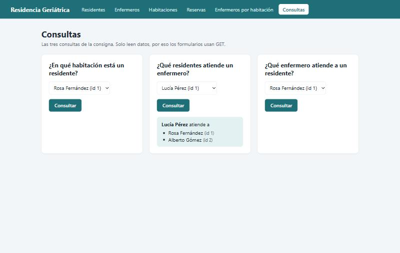
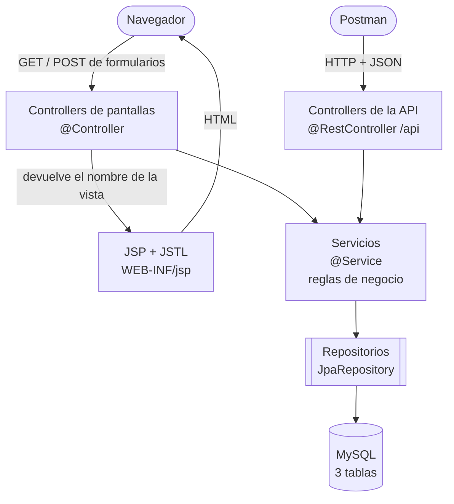
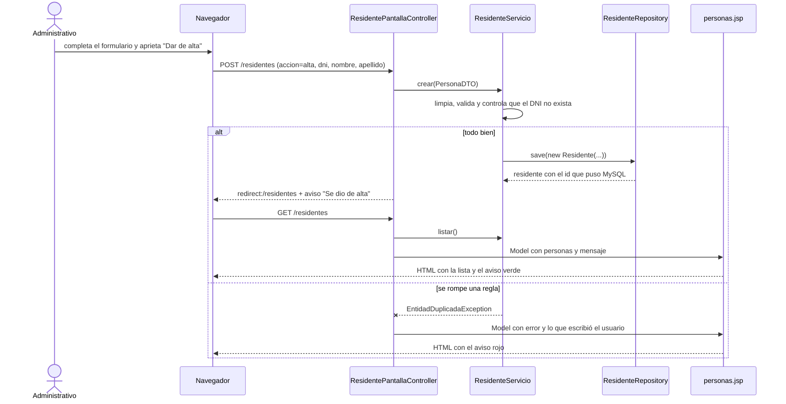
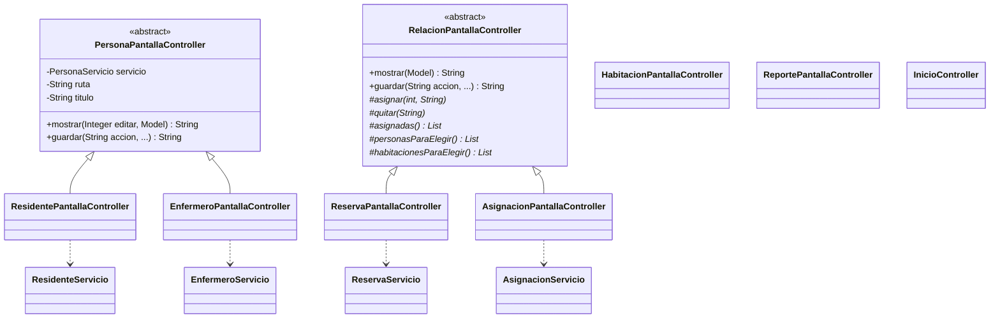
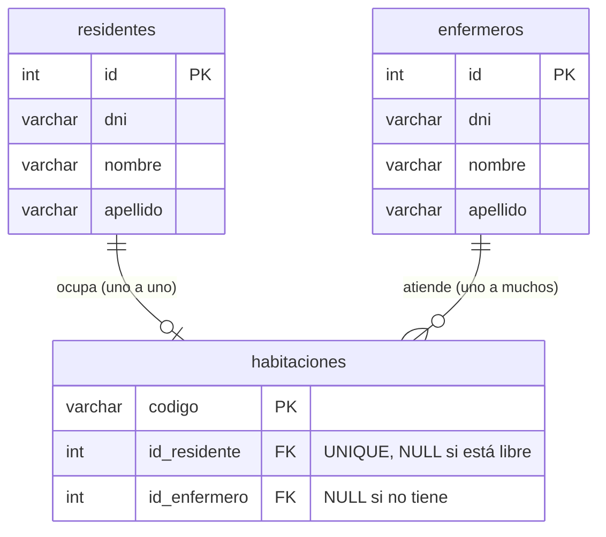

# Gestión de Residencia Geriátrica - Spring Boot (pantallas web + API REST)

Aplicación web para que el personal administrativo de una residencia geriátrica gestione residentes, enfermeros, habitaciones, reservas y asignaciones. **Backend y frontend están en un solo proyecto**: se ejecuta una sola aplicación, que muestra las pantallas en el navegador y además ofrece una API REST.

Proyecto de **Programación II** (INSPT-UTN). Es una de las versiones del mismo sistema:

| Versión | Qué es | Repositorio |
|---|---|---|
| Consola | MVC en capas con archivos de texto | [gestion-residencia-geriatrica-java-mvc](https://github.com/Emanuelbig/gestion-residencia-geriatrica-java-mvc) |
| API REST | Spring Boot + JPA + MySQL, solo JSON | [gestion-residencia-geriatrica-spring-api-rest](https://github.com/Emanuelbig/gestion-residencia-geriatrica-spring-api-rest) |
| Frontend separado | Servlets + JSP que consumen la API por HTTP | [gestion-residencia-geriatrica-frontend-jsp](https://github.com/Emanuelbig/gestion-residencia-geriatrica-frontend-jsp) |
| **Todo junto (este)** | Spring Boot con pantallas JSP y API REST en la misma aplicación | este repositorio |

La consigna original y dónde se cumple cada punto están en [docs/CONSIGNA.md](docs/CONSIGNA.md).



| Residentes | Habitaciones |
|---|---|
|  |  |
| **Reservas** | **Consultas** |
|  |  |

---

## Tecnologías

| | |
|---|---|
| Lenguaje | Java 21 |
| Framework | Spring Boot 4.1 (Spring Web MVC, Spring Data JPA, Validation) |
| Pantallas | JSP + JSTL (con Jasper, el compilador de JSP de Tomcat) y CSS propio |
| Persistencia | Hibernate (JPA) sobre MySQL |
| Build | Maven |

---

## Cómo ejecutarlo

1. **Crear la base con datos de prueba:** abrir [`base-de-datos.sql`](base-de-datos.sql) en MySQL Workbench y ejecutarlo (el rayo). Crea la base `geriatrico`, las 3 tablas, 4 residentes, 3 enfermeros y 5 habitaciones.
   Es la misma base que usa la versión API REST.
2. Crear `src/main/resources/secreto.properties` (al lado de `application.properties`) con tu usuario y contraseña de MySQL:
   ```properties
   spring.datasource.username=root
   spring.datasource.password=TU_CLAVE
   ```
   Este archivo está en `.gitignore`: la contraseña nunca se sube al repositorio.
3. Ejecutar con **F6** en NetBeans, o desde la terminal:
   ```bash
   mvnw spring-boot:run
   ```
4. Abrir **http://localhost:8080** en el navegador.

> El puerto 8080 tiene que estar libre: si está corriendo el Tomcat de NetBeans (el del frontend separado), hay que pararlo antes.

> Los JSP se sirven desde `src/main/webapp`, así que la aplicación se ejecuta desde NetBeans o con `mvnw spring-boot:run`. Un `.jar` empaquetado no incluye los JSP: es una limitación de Spring Boot con JSP.

---

## Qué tiene

### Pantallas (para el administrativo)

| URL | Qué hace |
|---|---|
| `/` | Menú principal |
| `/residentes` y `/enfermeros` | Listar, alta, modificar y baja |
| `/habitaciones` | Listar (libre / ocupada), ver el detalle, crear (el código se genera solo) y eliminar |
| `/reservas` | Ubicar a un residente en una habitación o liberarla |
| `/asignaciones` | Asignar o quitar el enfermero de una habitación |
| `/reportes` | Las 3 consultas de la consigna |

### API REST (para Postman u otro programa)

Los mismos datos en JSON, bajo `/api`:

| Recurso | Endpoints |
|---|---|
| `/api/residentes`, `/api/enfermeros` | `GET`, `GET /{id}`, `POST` → 201, `PUT /{id}`, `DELETE /{id}` → 204 |
| `/api/habitaciones` | `GET`, `GET /{codigo}`, `POST` sin body → 201, `DELETE /{codigo}` |
| `/api/reservas` | `GET`, `/residentes-sin-habitacion`, `/habitaciones-libres`, `POST ?idResidente=&codigo=`, `DELETE /{codigo}` |
| `/api/asignaciones` | `GET`, `/habitaciones-sin-enfermero`, `POST ?idEnfermero=&codigo=`, `DELETE /{codigo}` |
| `/api/reportes` | `/residentes/{id}/habitacion`, `/enfermeros/{id}/residentes`, `/residentes/{id}/enfermero` (204 si no tiene) |

Los errores responden `{"error": "..."}` con 400 (dato inválido), 404 (no existe) o 409 (regla que no se cumple).

Ejemplo: la misma habitación que muestra la pantalla de detalle, pedida como JSON con `GET /api/habitaciones/HAB-101`:

```json
{
  "codigo": "HAB-101",
  "residente": { "id": 1, "dni": "20345678", "nombre": "Rosa", "apellido": "Fernández", "nombreCompleto": "Rosa Fernández" },
  "enfermero": { "id": 1, "dni": "33456789", "nombre": "Lucía", "apellido": "Pérez", "nombreCompleto": "Lucía Pérez" },
  "ocupada": true
}
```

---

## Cómo funciona

Las pantallas y la API son **dos puertas de entrada al mismo sistema**. Las dos usan los mismos servicios, así que las reglas de negocio están escritas una sola vez.



### Separado vs. todo junto

| | Frontend separado + API | Todo junto (este) |
|---|---|---|
| Proyectos que se ejecutan | 2 (Tomcat 8080 + Spring 8081) | 1 (Spring 8080) |
| Cómo llega la pantalla a los datos | Por HTTP: `ApiCliente` + `HttpClient` + Jackson | Llamando al servicio directamente (lo inyecta Spring) |
| DTO | Duplicados en los dos proyectos | Una sola vez |
| Errores | La API responde 409 y el frontend lee el `{"error"}` | El controller atrapa la excepción del servicio |
| Ventaja | Otro cliente (una app móvil) puede usar la misma API; cada parte se despliega por separado | Menos código y una sola cosa para ejecutar |

### Recorrido de un pedido: alta de un residente desde la pantalla

1. El usuario completa el formulario de `personas.jsp` y aprieta **Dar de alta**. El navegador manda un `POST /residentes` con `accion=alta`, `dni`, `nombre` y `apellido`.
2. Spring busca quién atiende `/residentes`: `ResidentePantallaController`, que hereda el método `guardar` de `PersonaPantallaController`. Los campos del formulario llegan como parámetros con `@RequestParam`.
3. El controller arma un `PersonaDTO` y llama a `servicio.crear(datos)`. Es el mismo `ResidenteServicio` que usa la API.
4. Según lo que pasa en el servicio:
   - **Sale bien:** el aviso "Se dio de alta correctamente." se guarda con `RedirectAttributes.addFlashAttribute` y el controller devuelve `"redirect:/residentes"` (patrón *Post/Redirect/Get*: apretar F5 no repite el alta).
   - **Se rompe una regla** (por ejemplo, el DNI ya existe): el servicio lanza una `GeriatricoException`, el controller la atrapa, pone el mensaje en el `Model` y vuelve a mostrar el formulario con lo que el usuario había escrito.
5. El controller devuelve `"personas"`. Con `spring.mvc.view.prefix` y `suffix`, Spring abre `/WEB-INF/jsp/personas.jsp` y le pasa lo que hay en el `Model`.



### Herencia en los controllers de pantallas



- **`PersonaPantallaController`**: una sola clase para residentes y enfermeros. Cada hija solo pasa su servicio, su URL y su título. Es la misma idea que `PersonaController` en la API.
- **`RelacionPantallaController`** usa el patrón **método plantilla**. El recorrido (mostrar, asignar, quitar, avisar y redirigir) está escrito una vez, y las hijas solo dicen con qué servicio se hace cada paso.
- Del lado de la API (`controllers.api`) la estructura es la misma: `PersonaController` abstracto con `ResidenteController` y `EnfermeroController`, y un controller por recurso.

### Paquetes

| Paquete / carpeta | Qué tiene |
|---|---|
| `modelos` | Entidades JPA. `Persona` es `@MappedSuperclass` abstracta; `Residente` y `Enfermero` la heredan. `Habitacion` guarda su residente (`@OneToOne`, único) y su enfermero (`@ManyToOne`). |
| `repositorios` | Interfaces que extienden `JpaRepository`. Spring escribe la implementación. |
| `dto` | Lo que viaja hacia las pantallas y hacia el JSON. Las entidades no salen del servicio. |
| `servicios` | Las reglas de negocio. `PersonaServicio<T>` reúne lo común a residentes y enfermeros. |
| `excepciones` | `GeriatricoException` y sus hijas. |
| `controllers.api` | `@RestController` bajo `/api` y `ManejadorDeErrores`, que solo atiende a este paquete. |
| `controllers.pantallas` | `@Controller` que devuelven vistas JSP. `PersonaPantallaController` (abstracto) sirve para residentes y enfermeros; `RelacionPantallaController` (abstracto, método plantilla) sirve para reservas y asignaciones. |
| `webapp/WEB-INF/jsp` | Las vistas, y los fragmentos `encabezado.jspf` y `avisos.jspf`. |
| `resources/static` | `estilos.css`. |

### Base de datos: 3 tablas



- Ninguna relación es muchos a muchos, así que no hace falta una tabla intermedia: la reserva y la asignación son claves foráneas en la habitación.
- `id_residente` es **UNIQUE**: la base misma impide que un residente esté en dos habitaciones.
- En JPA: `@OneToOne @JoinColumn(name = "id_residente", unique = true)` y `@ManyToOne @JoinColumn(name = "id_enfermero")` en la entidad `Habitacion`.

### Reglas de negocio

- El DNI tiene 7 u 8 números y no se repite entre residentes y enfermeros.
- Nombre y apellido llevan solo letras y espacios; se guardan prolijos (`"  juan   carlos"` → `"Juan Carlos"`).
- Los ids los genera MySQL (`AUTO_INCREMENT`) y nunca se reutilizan. Los códigos de habitación los genera el sistema: HAB-101, HAB-102...
- Un residente ocupa como máximo **una** habitación, y una habitación tiene como máximo **un** residente.
- Un enfermero puede atender **varias** habitaciones, pero cada habitación tiene como máximo **un** enfermero.
- No se puede borrar nada que esté en uso: un residente con habitación, un enfermero con habitaciones, o una habitación ocupada o con enfermero.

### Estructura

```
src/main/
├── java/prog2/residenciageriatrica/
│   ├── ResidenciaGeriatricaApplication.java   arranca Spring Boot
│   ├── modelos/          Persona, Residente, Enfermero, Habitacion
│   ├── repositorios/     PersonaRepository, ResidenteRepository, EnfermeroRepository, HabitacionRepository
│   ├── dto/              PersonaDTO, HabitacionDTO, HabitacionDetalleDTO, PersonaHabitacionDTO
│   ├── servicios/        PersonaServicio + uno por tema (reglas de negocio)
│   ├── excepciones/      GeriatricoException y sus hijas
│   └── controllers/
│       ├── api/          @RestController bajo /api + ManejadorDeErrores
│       └── pantallas/    @Controller que devuelven JSP
├── resources/
│   ├── application.properties   base, JSP y sesión
│   ├── secreto.properties       usuario y clave de MySQL (no se sube)
│   └── static/estilos.css
└── webapp/WEB-INF/jsp/   inicio, personas, habitaciones, relaciones, reportes + encabezado.jspf y avisos.jspf
```

---

## Preguntas para la defensa oral

| Pregunta | Respuesta |
|---|---|
| ¿Qué diferencia hay entre `@Controller` y `@RestController`? | `@Controller` devuelve el **nombre de una vista** (un JSP). `@RestController` devuelve **datos** que Spring convierte a JSON. Acá conviven los dos. |
| ¿Por qué la API está en `/api`? | Para que no choque con las pantallas: `/residentes` es la pantalla y `/api/residentes` es el JSON. |
| ¿Por qué las pantallas no usan la API? | Porque están en el mismo programa: llamar al servicio directamente es más simple y más rápido que ir por HTTP. La API queda para clientes de afuera. |
| ¿Cómo no se repiten las reglas? | Pantallas y API usan los mismos servicios. La validación del DNI, por ejemplo, está escrita una sola vez en `PersonaServicio`. |
| ¿Qué es el `Model`? | Lo que el controller le pasa a la vista. `model.addAttribute("personas", lista)` hace que el JSP pueda usar `${personas}`. |
| ¿Qué hace `RedirectAttributes.addFlashAttribute`? | Guarda el aviso de éxito para el próximo pedido, el que llega después del redirect, y lo borra después de mostrarlo. |
| ¿Por qué `ManejadorDeErrores` tiene `basePackages`? | Para que solo transforme en JSON los errores de la API. En las pantallas, cada controller atrapa el error y lo muestra en rojo. |
| ¿Por qué los JSP están en `WEB-INF`? | Para que no se puedan abrir directo desde el navegador: siempre se pasa por el controller, que es el que carga los datos. |
| ¿Qué es el método plantilla en `RelacionPantallaController`? | La clase abstracta tiene el recorrido completo (mostrar, asignar, quitar) y deja abstractos los pasos que cambian. `ReservaPantallaController` los resuelve con `ReservaServicio`; `AsignacionPantallaController`, con `AsignacionServicio`. |
| ¿Por qué 3 tablas y no 5? | Porque ninguna relación es muchos a muchos ni tiene datos propios. `UNIQUE` en `id_residente` hace cumplir el uno a uno desde la base. |

---

**Autor:** Emanuel Morano Solé · Programación II · Turno Noche
